<div align="center">

# CustomerSignal AI

### Turn Customer Feedback Into Your Next Business Opportunity.

AI-powered customer intelligence: analyze reviews, uncover recurring complaints, monitor competitors,
and turn feedback into evidence-backed opportunities, outreach and branded PDF reports.

[](https://render.com/deploy?repo=https://github.com/aqkprogrammer/customersignal-ai)

    

</div>

<p align="center">
  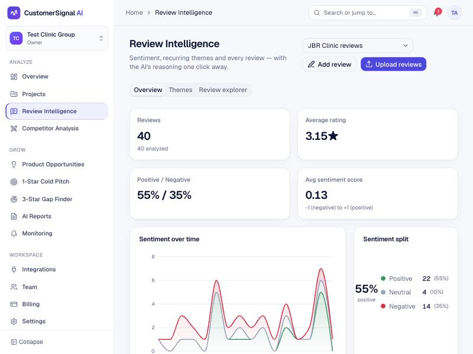
  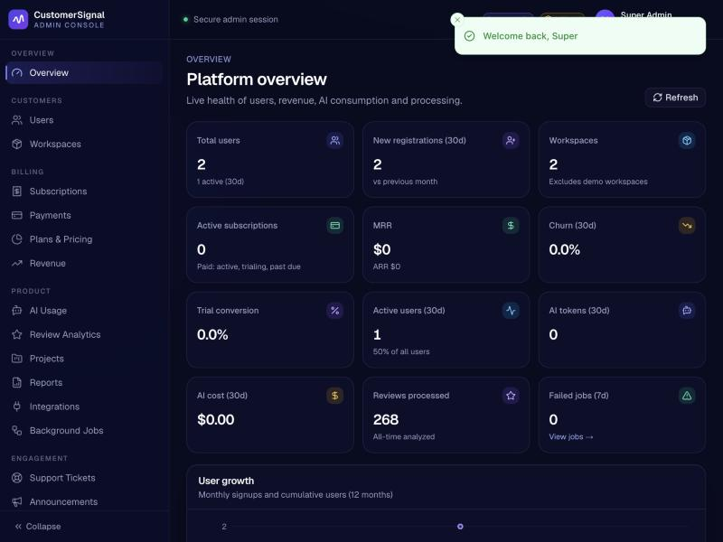
</p>

---

## Contents

- [What it does](#what-it-does)
- [System architecture](#system-architecture)
- [Workflows](#workflows) — auth & tenancy · review analysis · background jobs · 1-star cold pitch · 3-star gap finder · billing
- [Data model](#data-model)
- [Quick start](#quick-start) · [Deploy to Render](#deploy-to-render) · [Project structure](#project-structure)
- [Documentation](#documentation)

## What it does

| Area | Highlights |
| --- | --- |
| **Marketing site** | Home, features, 5 industry pages, live pricing, contact form, blog, legal pages, sitemap, robots, OpenGraph, JSON-LD |
| **Auth** | Email/password, Google OAuth, email verification, password reset, refresh-token rotation, session management, CSRF, rate limits |
| **Review Intelligence** | CSV/Excel/manual/API ingestion → validation → dedupe → language detection & translation → sentiment, emotion, complaints, praise, feature requests → pgvector embeddings → theme clustering with severity & trends → semantic search & CSV export |
| **1-Star Review Cold Pitch** | Lead pipeline, ranked issues with **verbatim** review evidence, cold email / LinkedIn / follow-up drafts, one-page PDF, HubSpot sync |
| **3-Star Gap Finder** | Likes, dislikes, wishes, missing features, unmet expectations, competitor advantages, opportunity score, roadmap |
| **Competitors** | Side-by-side sentiment, ratings, complaint heat-map, trend lines, AI strengths/weaknesses |
| **AI Reports** | 9 report types → branded PDF with charts & evidence, secure expiring share links |
| **Monitoring** | 6 rule types evaluated hourly, in-app + email alerts, signed webhooks |
| **Team & billing** | Owner/Admin/Analyst/Viewer, invitations, Stripe Checkout/Portal/webhooks, plan limits enforced server-side |
| **Admin console** | Separate auth + TOTP MFA, 4 admin roles, users, workspaces, subscriptions, revenue, plans, AI usage & cost, jobs, support, announcements, email templates, audit logs, feature flags, settings |

> **No AI key? It still works.** A transparent built-in keyword engine runs when no provider is configured (and is
> labelled as such everywhere). Add `ANTHROPIC_API_KEY` (default `claude-opus-5-5`) or `OPENAI_API_KEY` for LLM
> analysis with validated structured outputs.

## System architecture

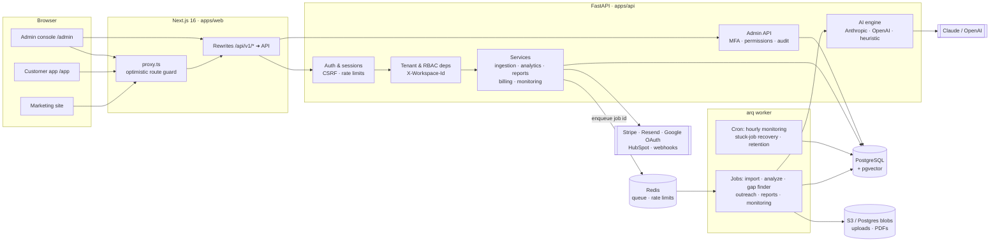

The browser only talks to the Next.js origin; `/api/v1/*` is proxied to FastAPI so session cookies are first-party.
Every check that matters — authentication, workspace membership, roles, plan limits, admin permissions — runs on the
API. See [docs/architecture.md](docs/architecture.md).

## Workflows

<details open>
<summary><b>Authentication, sessions & tenant isolation</b></summary>

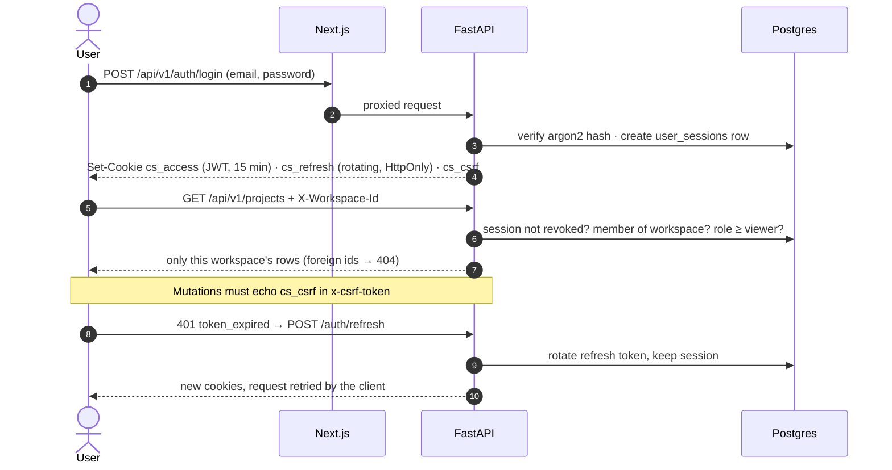

Google OAuth uses the authorization-code flow with a signed state cookie; accounts link only on a
**Google-verified** email, so duplicates can't be created.
</details>

<details open>
<summary><b>Review analysis pipeline</b></summary>

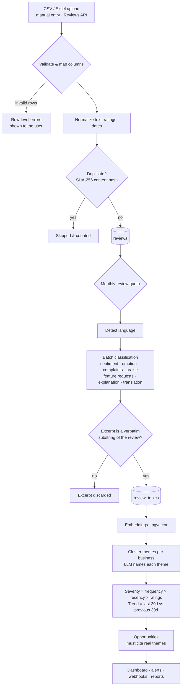

Each AI step runs through `AIEngine`: per-workspace token quota → provider call with structured JSON schema →
Pydantic validation → usage & cost log. If a provider fails, that step uses the built-in engine and the job shows a
warning; it never fails silently.
</details>

<details>
<summary><b>Background job lifecycle</b></summary>

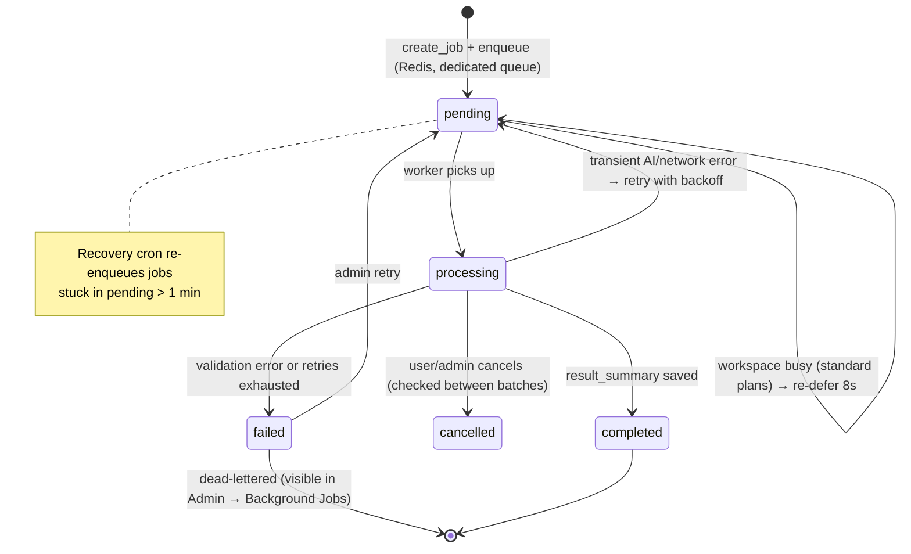
</details>

<details>
<summary><b>1-Star Review Cold Pitch (Opportunity Finder)</b></summary>

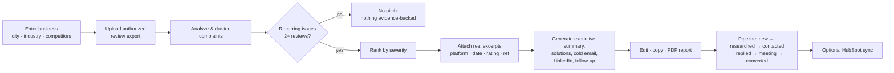
</details>

<details>
<summary><b>3-Star Gap Finder</b></summary>

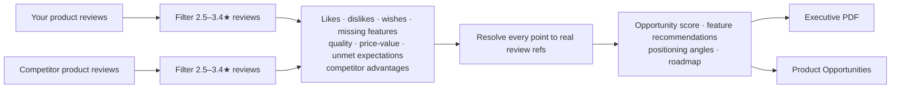
</details>

<details>
<summary><b>Subscription & billing</b></summary>

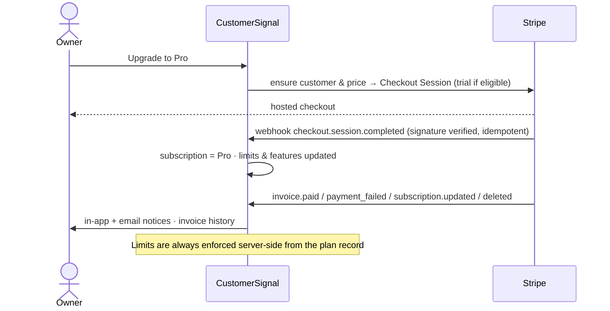
</details>

## Data model

47 tables with UUID keys, foreign keys, soft deletes and `workspace_id` on every tenant-owned row.
Full reference: [docs/database.md](docs/database.md).

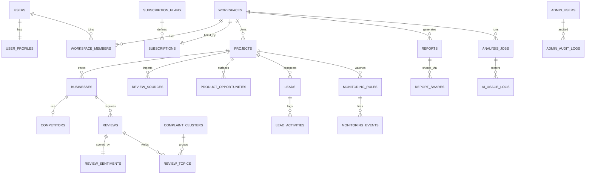

## Quick start

Prerequisites: Python 3.12+ with [uv](https://docs.astral.sh/uv/), Node 20.9+ with pnpm, PostgreSQL 15+ with
`pgvector`, Redis 7+ — or just Docker.

```bash
cp .env.example .env          # every external key is optional for local use
createdb customersignal
make setup && make migrate
make demo                     # demo user + DEMO workspace (prints the password once)
```

Run in three terminals:

```bash
make api       # FastAPI :8000 — docs at /api/docs
```

```bash
make worker    # background jobs
```

```bash
make web       # Next.js :3000
```

Without `RESEND_API_KEY`, verification/reset emails are printed to the API log. No worker? Set `JOBS_INLINE=true`.

**Docker:**

```bash
docker compose up --build
```

## Deploy to Render

[`render.yaml`](render.yaml) provisions the whole stack on Render's free tier: Next.js web service, FastAPI API (with
the job worker in the same container), Postgres with pgvector, and Key Value (Redis). Click **Deploy to Render**
above, then create the first admin:

```bash
curl -X POST https://customersignal-ai-api.onrender.com/api/v1/admin/auth/bootstrap \
  -H 'content-type: application/json' \
  -d '{"email":"<ADMIN_BOOTSTRAP_EMAIL>","password":"<a strong password>","bootstrap_secret":"<ADMIN_BOOTSTRAP_SECRET from the Render dashboard>"}'
```

Free-tier caveats: services sleep when idle (first request takes ~30–60 s), and free Postgres expires after 30 days
unless upgraded. Details and the paid-tier layout: [docs/deployment.md](docs/deployment.md).

## Screenshots

| AI report (in app) | PDF report |
| --- | --- |
| 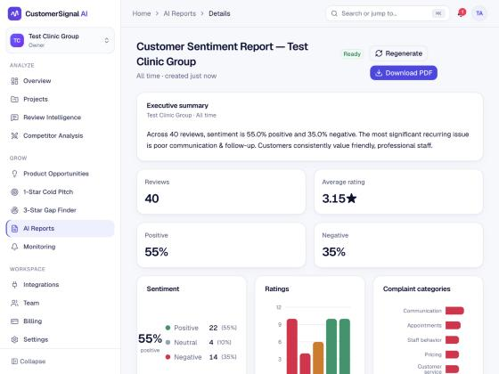 | 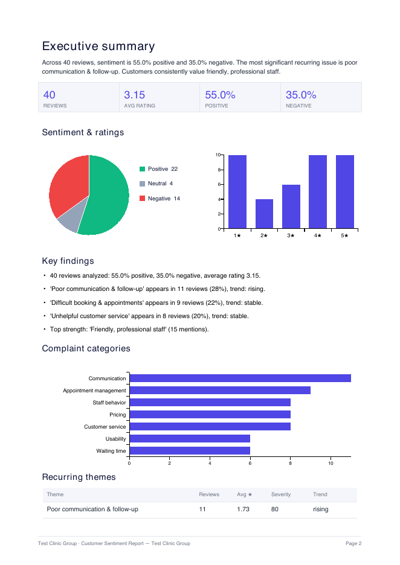 |

## Project structure

```
customersignal-ai/
├── apps/api/                 FastAPI backend (Python 3.13)
│   ├── app/ai/               provider abstraction, prompts, schemas, embeddings, heuristic engine
│   ├── app/api/v1/routes/    customer REST API
│   ├── app/api/v1/admin/     admin auth + admin REST API
│   ├── app/core/             config, DB, security, errors, rate limiting, storage
│   ├── app/models/           SQLAlchemy 2.0 models
│   ├── app/services/         ingestion, analysis, intelligence, reports/PDF, billing, monitoring
│   ├── app/workers/          job runner + arq worker
│   ├── migrations/           Alembic
│   └── tests/                pytest (95)
├── apps/web/                 Next.js 16 (App Router, Tailwind v4, shadcn/ui, Recharts)
│   ├── app/(marketing)/      public site
│   ├── app/(auth)/           login, signup, verify, reset, OAuth callback
│   ├── app/(dashboard)/app/  customer app
│   ├── app/admin/            admin console
│   └── tests/                Vitest (26) + Playwright (9)
├── docs/                     architecture, database, API, setup & deployment guides
├── render.yaml               Render blueprint (full stack)
├── docker-compose.yml
└── Makefile
```

## Documentation

| Guide | |
| --- | --- |
| [Architecture](docs/architecture.md) | Components, security model, AI engine, jobs |
| [Database](docs/database.md) | Tables, relationships, constraints, seeding, retention |
| [API](docs/api.md) | Conventions, endpoints, Reviews API, webhook signatures |
| [Local development](docs/local-development.md) | Setup, ports, dev settings, migrations |
| [Testing](docs/testing.md) | pytest, Vitest, Playwright |
| [Deployment](docs/deployment.md) | Render, Vercel, Railway, Docker |
| [Google OAuth](docs/oauth-setup.md) · [Stripe](docs/stripe-setup.md) · [AI providers](docs/ai-providers.md) | Integrations |
| [Admin bootstrap](docs/admin-bootstrap.md) · [Troubleshooting](docs/troubleshooting.md) | Operations |

## Principles

- **Authorized data only** — uploads, official APIs and approved providers; no scraping or bypassing platform controls.
- **Evidence over claims** — every quote is verbatim, every opportunity cites real themes, synthetic data is labelled DEMO.
- **Server-side enforcement** — auth, tenancy, roles, plan limits and admin permissions never trust the client.
- Legal pages ship as templates and must be reviewed by counsel before launch.

## License

[MIT](LICENSE)
